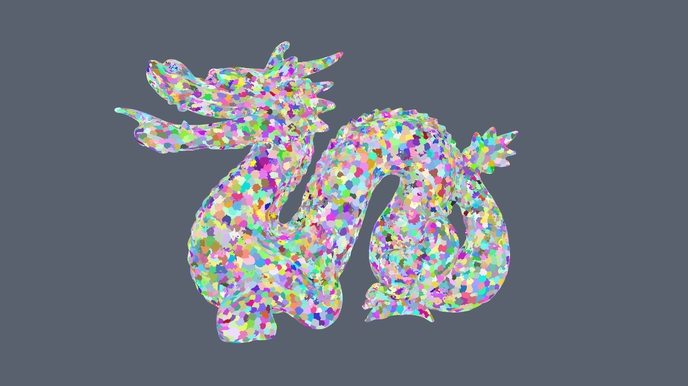
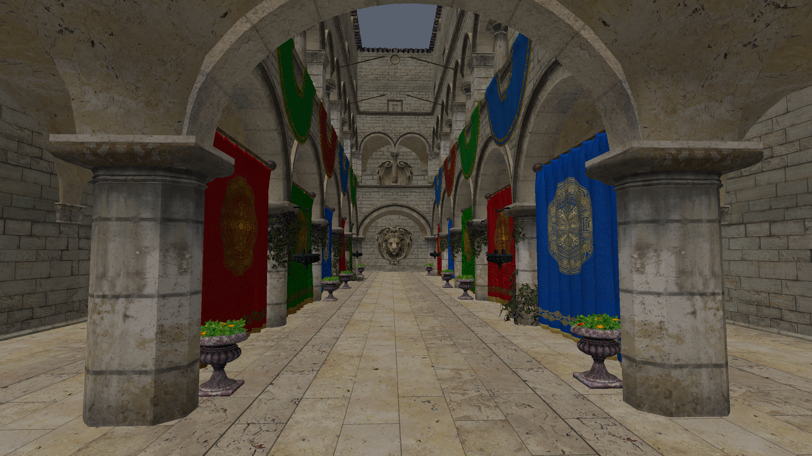
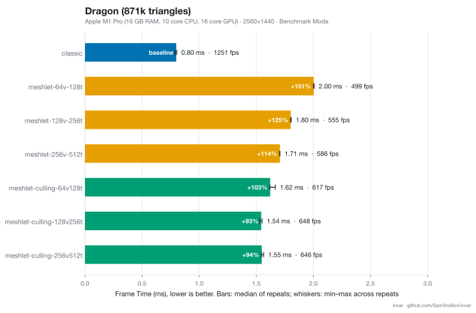
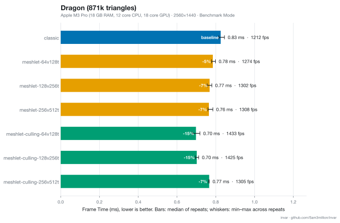
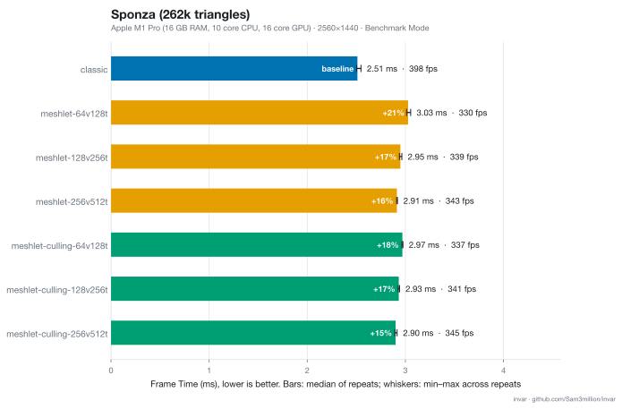
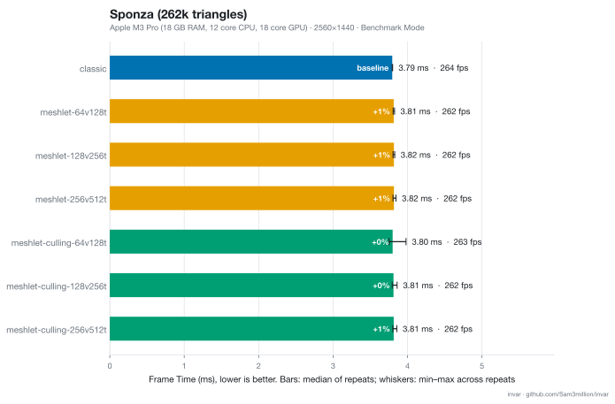

# invar

A GPU-driven renderer in C++ and Metal (metal-cpp), built to explore
mesh shaders, meshlet culling and GPU performance measurement on Apple silicon.

Read a detailed blog post about it [here](https://sam3million.github.io/gamedev/2026/09/30/metal-compute-renderer.html).

## Status
- [x] SDL3 window + CAMetalLayer, frames in flight, depth buffer (reversed-Z)
- [x] glTF loading, fly/orbit camera, performance counters + CSV export
- [x] Textures / materials
- [x] Meshlet build + mesh shader path
- [x] Meshlet frustum/cone culling (CPU reference validation in progress)
- [ ] Hi-Z occlusion culling
- [ ] Lighting
- [ ] Shadows
- [ ] PBR

## Requirements
- macOS with an Apple Silicon GPU (mesh shaders need Metal 3-class hardware)
- Xcode (with the Metal toolchain), CMake 3.24+

## Build
    git clone --recurse-submodules https://github.com/Sam3million/invar.git
    cd invar
    cmake -S . -B build -DCMAKE_BUILD_TYPE=Release
    cmake --build build
    ./build/invar

## Test assets
Models are not included. Download Sponza and other assets from the
[glTF Sample Assets](https://github.com/KhronosGroup/glTF-Sample-Assets) and place it under `assets/models/`.

## Controls
| Input              | Action                               |
|--------------------|--------------------------------------|
| Hold RMB + WASD/QE | Fly (Shift = faster, scroll = speed) |
| Alt + LMB drag     | Orbit                                |
| MMB drag           | Pan                                  |
| Scroll             | Dolly                                |
| F                  | Frame the scene                      |
| L                  | Lock/Unlock meshlet culling          |
| 1                  | Toggle frustum culling               |
| 2                  | Toggle cone culling                  |

## Benchmarks
### Stanford Dragon

*M1 Pro Results (slower due to lack of hardware mesh shader support)*

*M3 Pro Results*
### Sponza

*M1 Pro Results (slower due to lack of hardware mesh shader support)*

*M3 Pro Results (not sure why it's slower than M1, maybe the lower memory bandwidth)*

## Third-party
metal-cpp (Apache-2.0), SDL3 (zlib), meshoptimizer (MIT), cgltf (MIT), stb_image and stb_image_write (public domain / MIT), argparse (MIT)

## License
MIT. See `LICENSE`.