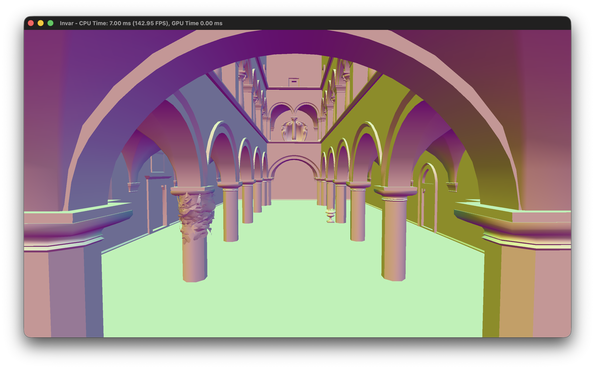

# invar

A from-scratch GPU-driven renderer in C++ and Metal (metal-cpp), built to explore
mesh shaders, meshlet culling and GPU performance measurement on Apple silicon.

## Status
- [x] SDL3 window + CAMetalLayer, frames in flight, depth buffer (reversed-Z)
- [x] glTF loading, fly/orbit camera, performance counters + CSV export
- [ ] Meshlet build + mesh shader path
- [ ] Meshlet frustum/cone culling with CPU reference validation
- [ ] Hi-Z occlusion culling
- [ ] Textures / materials

## Requirements
- macOS with an Apple silicon GPU (mesh shaders need Metal 3-class hardware)
- Xcode (with the Metal toolchain), CMake 3.24+

## Build
    git clone --recurse-submodules https://github.com/Sam3million/invar.git
    cd invar
    cmake -S . -B build -DCMAKE_BUILD_TYPE=Release
    cmake --build build
    ./build/<executable>

## Test assets
Models are not included. Download Sponza from the
[glTF Sample Assets](https://github.com/KhronosGroup/glTF-Sample-Assets) and place it under `assets/models/`.

## Controls
| Input | Action |
|---|---|
| Hold RMB + WASD/QE | Fly (Shift = faster, scroll = speed) |
| Alt + LMB drag | Orbit |
| MMB drag | Pan |
| Scroll | Dolly |
| F | Frame the scene |

## Benchmarks
In progress.

## Third-party
metal-cpp (Apache-2.0), SDL3 (zlib), meshoptimizer (MIT), cgltf (MIT), stb_image (public domain / MIT).

## License
MIT. See `LICENSE`.